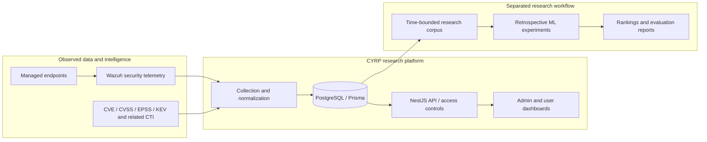

# AegisPulse / CYRP — Research Case Study

**Cybersecurity risk prioritization, vulnerability intelligence and endpoint-security engineering**

> **Research status (18 October 2026):** Ongoing team research; source code and datasets are private. This page is a public, non-operational overview of documented internal work. Research results are **retrospective**, pending independent academic acceptance, and are **not** evidence of real-world exploitation prediction or production safety.

[Back to Vo Dinh Hoang Anh's GitHub profile](../README.md) · [ATED 2026 — official conference website](https://ated.stu.edu.vn/en/) · [ORCID — Vo Dinh Hoang Anh](https://orcid.org/0009-0009-9602-0332)

## Research question

How can teams combine endpoint context and vulnerability intelligence to rank vulnerabilities for investigation, while making the evidence, assumptions, uncertainty and resource-monitoring costs explicit?

CYRP is not intended to replace Wazuh, a SIEM, exploit confirmation, expert review, or a vulnerability management program. A ranking score alone does not establish the probability that a particular endpoint will be compromised.

## Research team and contributions

The research manuscript identifies the following team:

- **Lê Minh Phúc** — student project lead and co-author; vulnerability data, labelling and model-focused research work.
- **Võ Đình Hoàng Anh** — student co-researcher and co-author; endpoint/client integration, telemetry, application/dashboard development, system testing and model-evaluation support.
- **ThS. Mai Vân Phương Vũ** — academic supervisor and manuscript co-author.

Responsibilities are described at the level documented by the team's research proposal. They do not imply that any individual built every subsystem alone.

**Affiliation:** Faculty of Information Technology, Saigon Technology University (STU), Vietnam.

## System architecture

*Conceptual architecture: illustrates software components and research flows, not an independently certified deployment or autonomous security response.*

### Implemented engineering components

| Area | Documented implementation |
| --- | --- |
| Security data | Wazuh Agent enrolment/binding, vulnerability state and endpoint context collection |
| CTI | Source acquisition/normalization with historical provenance and cutoff-aware research assembly |
| Backend | NestJS APIs, PostgreSQL/Prisma, authentication, role-based access, audit events |
| Web applications | Administration and user portals for devices, vulnerability records and sync status |
| Research ML | Offline feature comparison, fixed protocols, training/evaluation splits and experiment artifacts |

### Planned / experimental, not validated operational capabilities

- Resource-budgeted adaptive telemetry with monitoring-profile comparisons.
- Empirical measurement of monitoring cost versus detection coverage under controlled treatments.
- External/out-of-time validation for prospective prioritization use.
- Independent acceptance of research results and evidence.

The most recent resource-estimation demo in the private project is **synthetic**. Its environmental status is `EMPIRICAL_RUN_BLOCKED_BY_ENVIRONMENT`; it is **not** evidence of realized resource savings.

## Retrospective results documented internally

The private research record describes a corrected time-bounded corpus containing **375,957 CVE records** and a **278,948-CVE primary feature-ablation cohort**. These are different populations; do not conflate them.

The following results are **mean test PR-AUC over three research seeds (17, 42 and 73)** from the internal Phase 0C4 experiment; they have not been independently peer-reviewed.

| Model | CVSS-only (F0) | CVSS + cutoff-safe EPSS (F2) |
| --- | ---: | ---: |
| Logistic Regression | 0.020811 | 0.324998 |
| XGBoost | 0.017705 | 0.242290 |

**Correct interpretation:**

1. In this **retrospective** corpus, including EPSS supplied much of the observed ranking improvement over CVSS-only features.
2. The experiment does **not** establish that the model independently discovered future exploitation risk. EPSS is itself an external exploitation-prioritization signal.
3. Publication-age/source biases remain material; prospective predictive validity is **not established**.
4. No winning research model was selected for production activation from these results.

A later internal EPSS-isolation comparison reported mean PR-AUC of **0.223434** (raw EPSS), **0.223182** (learned EPSS-only) and **0.324998** (CVSS + EPSS comparator). The controlled analysis did **not** find a stable incremental CVSS gain in the dependence-aware intervals; it concluded that raw EPSS explains much of the ranking signal.

**Evidence boundary:** These values are transcribed from the private project's `PROJECT_STATUS.md`, `docs/research/PHASE_0C4_RESULTS.md` and `IMPLEMENTATION_REPORT.md`. Original experiment artifacts, validation inputs and reviewer sign-off remain private. The public page alone is not a reproducible independent verification package.

### Software verification status

The latest internal Phase 0D3D closeout reports **386/386 API tests** and **32/32 end-to-end tests** passing, plus lint, type checking and three application builds. This is **internal project verification**, not a security certification, external audit or independent replication. The latest empirical adaptive-monitoring study is still blocked by its environment and cannot be reported as complete.

## Awards and academic activity

**Student scientific research:** the project team reports a **Second Prize in a Student Scientific Research Competition**. The exact award title, organizing body, award date and public certificate link remain to be attached. This is an author-reported achievement until those records are published.

**ATED 2026 manuscript:** a team manuscript titled *Machine Learning-Based Vulnerability Exploitation-Risk Prioritization for Proactive Vulnerability Management* has been prepared/revised for the **International Conference on Artificial Intelligence, Technology, Engineering and Design (ATED 2026)**, scheduled for **29–31 October 2026** at Saigon Technology University.

- [Official ATED 2026 conference information](https://ated.stu.edu.vn/en/)
- **Submission, acceptance, presentation and proceedings publication:** not independently verified from the available documents. This page makes **no claim** of acceptance, presentation or publication.
- Conference dates are the event's schedule, **not a claim that the author has already attended**.

If confirmed by the team, the official abstract/paper submission receipt, acceptance letter, program entry and DOI/ISBN proceedings link can be added individually and dated.

## Research limitations and responsible disclosure

- Endpoint-risk rankings are not calibrated attack or exploitation probabilities for an organization.
- Real-world detection coverage, false alarms and endpoint overhead under an adaptive telemetry controller have not been established by empirical treatment.
- Source snapshots, labelling, time cutoffs and cohort shift affect the interpretation of results.
- The codebase, raw CTI snapshots, training dataset, model artifacts, infrastructure topology, log records and credentials are intentionally **not** distributed here.
- This case study is a research portfolio summary; it must not be used for automated mitigation, procurement, or operational security assurance.

## Public academic identity

**Vo Dinh Hoang Anh** — [ORCID 0009-0009-9602-0332](https://orcid.org/0009-0009-9602-0332) *(identifier supplied in the team's manuscript; verify ownership before final release).*

---

*Research overview updated 18 October 2026. Quantitative statements are internal retrospective results, not independently accepted or prospectively demonstrated claims.*
